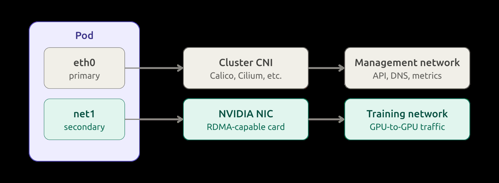
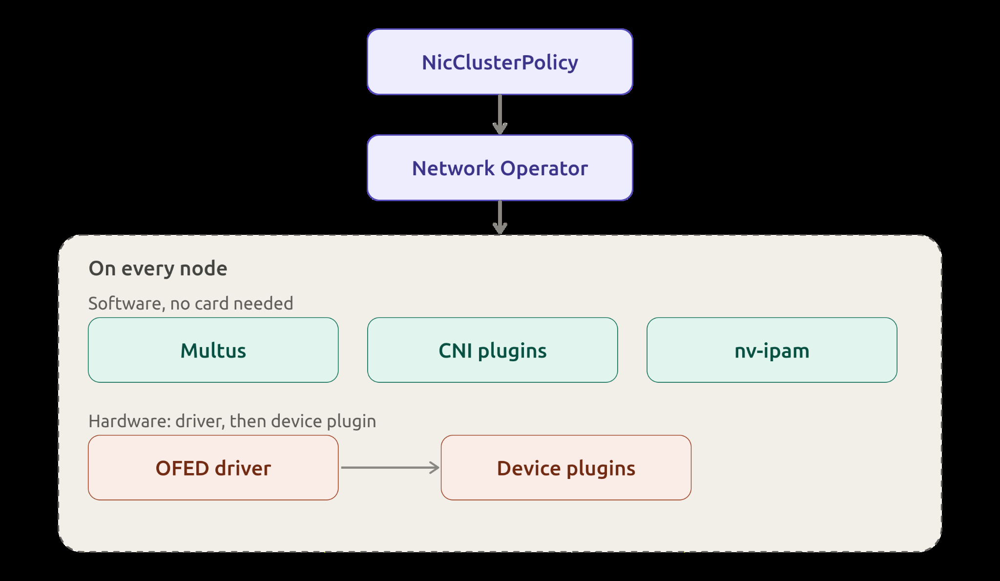
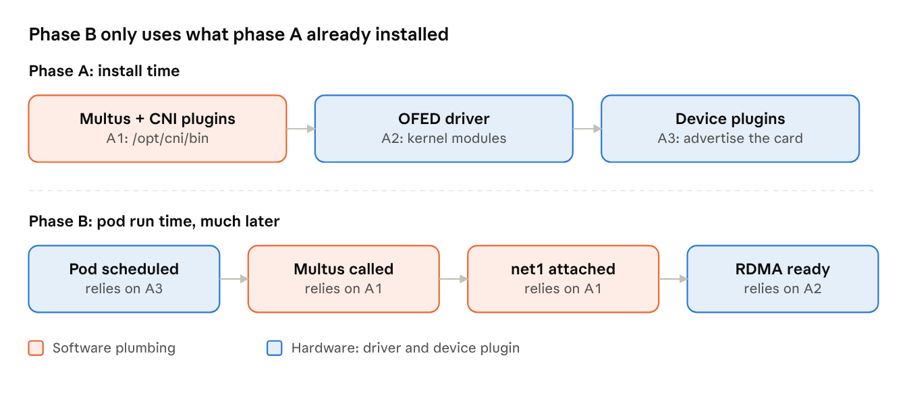

*A beginner's guide for engineers who work with software but want to understand what happens underneath*

<!-- truncate -->

## Why this post exists

I work with Kubernetes, Docker and the usual DevOps toolbox every day. Then I started reading about secondary networks for GPU workloads and found excellent material, along with a lot of vocabulary I hadn't needed before: PF, VF, RDMA, RoCE, PKEY, etc.

So I started from zero, studied the NVIDIA Network Operator piece by piece, and wrote down every question as it came up. This post is those answers, in the order I wish someone had given them to me, so the more advanced material should read like a conversation you can join.

No hardware knowledge is assumed. If you know what a Pod, a CNI plugin and a DaemonSet are, you are ready.

---

## Why a GPU pod needs two networks

Every pod you have ever run has one network interface, `eth0`, provided by your CNI plugin (Flannel, Calico, Cilium, etc.). It is great at what Kubernetes needs: service discovery, DNS, health checks, metrics, talking to the API server.

Now picture a model being trained across many machines. After every step, every GPU has to share what it learned with every other GPU, and that means moving hundreds of gigabytes, over and over, as fast as the hardware allows. This traffic is called collective communication (all-reduce and friends).

That is a very different job from serving an API request, and `eth0` is the wrong tool for it. The pod network usually involves an overlay, kube-proxy rules, and the CPU copying every packet through the operating system.

So GPU clusters run **two networks side by side**:

- **The management network:** the normal Kubernetes pod network on `eth0`. Low bandwidth.
- **The training network:** a separate, dedicated, very fast path between machines, used only for GPU-to-GPU traffic.



The `eth0` interface goes through the cluster CNI to the management network, and `net1` goes through the fast NIC to the training network.

The training network is what people mean by a *secondary network*. A pod that has both looks like this from the inside:

```text
eth0  10.244.1.6/24      <- primary: the normal cluster network
net1  192.168.0.101/24   <- secondary: the extra, dedicated network
```

The rest of this post is about how that second interface gets there, and what has to be in place first.

---

## Hardware words you actually need

These are the few words that everything else leans on.

**NIC (network interface card).** The physical card in a server that connects it to a network cable. Your laptop has one too, it's just built in. GPU servers have special, much faster ones, with NVIDIA's ConnectX line (originally Mellanox) as the common example.

**Driver.** A piece of software, loaded into the host's Linux kernel, that lets the operating system talk to a piece of hardware. Without the right driver, the card is just a lump of metal in a PCIe slot. This matters for Kubernetes because the kernel is per machine: a driver loaded on server A does nothing for server B. That is why the operator ships the driver as a DaemonSet, one driver pod per node.

**RDMA (remote direct memory access).** Normally, sending data over the network means the CPU copies it through the OS, packet by packet. RDMA lets the network card read from and write to memory on another machine directly, without involving the CPU or the OS on the data path. For GPU clusters this goes a step further: the card can move data to and from GPU memory.

**Ethernet (RoCE) vs InfiniBand.** Two kinds of network fabric that can carry RDMA. Ethernet is what the rest of the world uses, and RDMA over it is called RoCE. InfiniBand is a separate, purpose-built fabric common in HPC and some large training clusters. Most cloud and enterprise setups are on Ethernet, so that is what we'll assume.

**PF and VF.** A single physical card can present itself as one device (the Physical Function) or be split into many smaller virtual devices (Virtual Functions). For now, just know it exists, because it is one of the ways a pod can be given a slice of a card.

---

## How a pod gets a second interface: Multus

Kubernetes only knows about one pod network by design. To attach more, you add **Multus**, a CNI plugin that acts as a coordinator. Multus lets your normal CNI plugin do its usual job for `eth0`, then calls additional CNI plugins to create extra interfaces.

You describe each extra network with a Kubernetes object called a **NetworkAttachmentDefinition**, and a pod opts in with a single annotation:

```yaml
metadata:
  annotations:
    k8s.v1.cni.cncf.io/networks: macvlan-net1
```

That annotation is the entire user-facing API. If the named network exists, the pod starts with `net1` next to `eth0`.

Two more things are needed to make that interface useful:

1. **A CNI plugin that knows how to create the interface**, such as `macvlan`, which builds a virtual interface on top of a real network card.
2. **An IPAM (IP address management) plugin** to hand the new interface an address.

---

## What the NVIDIA Network Operator does for you

You could install all of this by hand: the driver, Multus, CNI plugins, device plugins, IPAM. On a handful of machines, that works. On dozens, keeping driver versions and configs in sync becomes its own job.

The NVIDIA Network Operator takes that job over. You describe the stack you want in a single custom resource called `NicClusterPolicy`, and the operator makes it happen: it deploys the driver, the device plugins, Multus, the CNI plugins and IPAM, and keeps them healthy. Separate, smaller resources (`MacvlanNetwork`, `HostDeviceNetwork` and so on) turn into the `NetworkAttachmentDefinition`s Multus needs.



You write one `NicClusterPolicy`, and the operator deploys the software plumbing and the hardware track onto every node.

---

## Two tracks, one real dependency

Multus and the CNI plugins stand alone (the operator installs them as DaemonSets on every node and waits until they are healthy), the driver must come before the device plugin, and the pod needs both.

```text
Multus + CNI plugins ─────────────────────┐
                                          ├──► pod gets net1 + RDMA
OFED driver ──► device plugin ────────────┘
```

The operator applies them in the right order, so a device plugin never starts before the driver. If it does, it finds no hardware and crash-loops. So the operator puts a "traffic light" label on every node to hold the device plugins back until the driver is ready:

- `network.nvidia.com/operator.mofed.wait="true"`: red light, the driver is still being installed, device plugins must not run here.
- `network.nvidia.com/operator.mofed.wait="false"`: green light, the driver is ready, device plugins may start.

Once I understood that, a lot of the operator's behavior stopped looking like magic and started looking like ordinary Kubernetes scheduling rules.

---

## Install time vs. pod run time

The order above only matters in two phases that are far apart in time.



**Phase A: install time (preparing each node).** This happens when you apply the `NicClusterPolicy`.

1. Multus and the CNI plugins are installed first. Their binaries land in `/opt/cni/bin/`, so the node can handle secondary networks.
2. The OFED driver runs. It compiles and loads its kernel modules into the host OS.
3. The device plugins run. The driver is loaded, so they can find the card and register it with the kubelet as a resource.

**Phase B: pod run time (much later, when someone launches a workload).** A user creates a pod that asks for a secondary network and an RDMA device.

1. The pod is scheduled onto the node, because the device plugin advertised the card.
2. When the pod starts, Multus is called. It was installed in step 1 of phase A.
3. Multus attaches the secondary interface to the pod.
4. The driver was loaded in step 2 of phase A, so the pod can send RDMA traffic over the card right away.

---

## IP addresses on the second network

The second interface needs addresses too, and this is where a quiet problem lives.

The usual choice, `host-local`, keeps its bookkeeping on each node's own disk, so two nodes on the same subnet can hand out the same IP. A cluster-wide alternative like `whereabouts` avoids that but takes a cluster-wide lock for every address, which hurts when a training job launches hundreds of pods at the same second.

NVIDIA's IPAM, **nv-ipam**, avoids both problems by handing each node a block of addresses in advance. A pod's IP then comes from its own node's block, with no cluster-wide lock at start time. You describe the subnet once in an `IPPool` resource and point your secondary network at it by name.

---

## Four ways to attach the interface

So far I have said "a CNI plugin creates the interface on top of a real card" without saying *how*. There are four common answers:

- **Macvlan:** a virtual interface on top of the card. Many pods share it. Simplest to start with.
- **Host-device:** the whole physical card is moved into one pod. Exclusive access, no sharing.
- **SR-IOV:** the card is split into virtual functions in hardware, and each pod gets its own slice.
- **IPoIB:** IP over InfiniBand, for clusters using that fabric instead of Ethernet.

Each has trade-offs in isolation, performance and setup effort. The deep comparison is covered very well in [Understanding Secondary Networks for GPU Workloads in Kubernetes](/blog/secondary-networks-gpu-kubernetes). That post should now be a lot easier to read.

---

## What I'd tell my past self

- A secondary network is just a second interface on the pod, `net1` next to `eth0`. The complexity is in what's underneath it.
- The hardware vocabulary is short. NIC, driver, RDMA, the two fabrics, PF/VF is enough to begin with.
- Multus plus a `NetworkAttachmentDefinition` plus one annotation is the Kubernetes-side API.
- The Network Operator is mostly about ordering and lifecycle: drivers before device plugins, with a label acting as a traffic light between them.
- You don't need a rack to learn the Kubernetes side.
